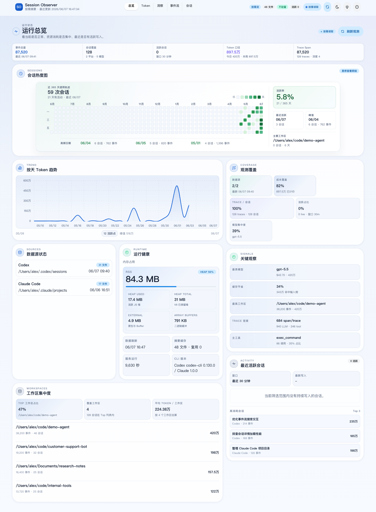
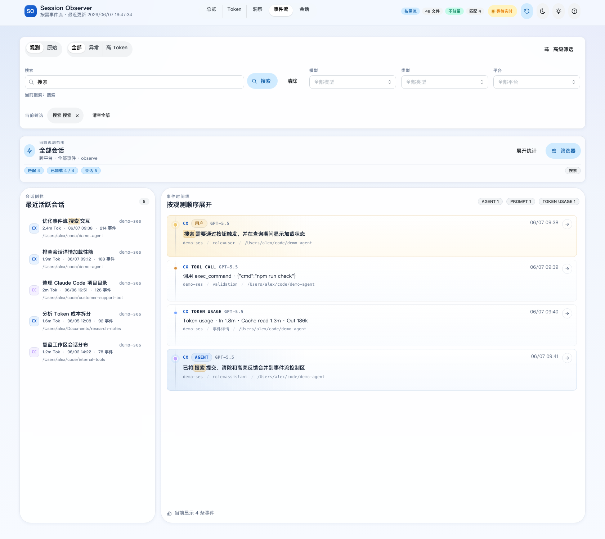
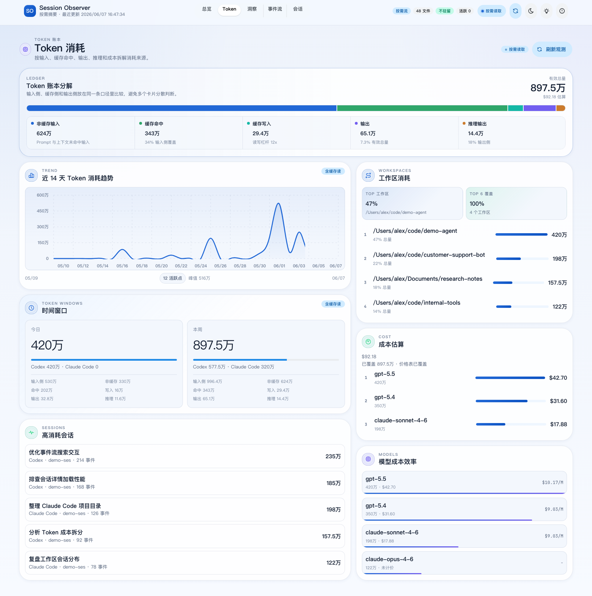
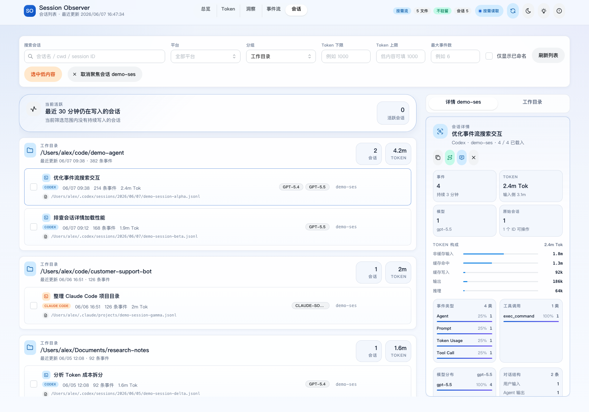

# Session Observer

**A local-first observability workbench for Codex, Claude Code and Qwen Code.** Turn scattered JSONL transcripts into a semantic activity stream, searchable session library, token and cost ledger, and runtime health dashboard - without uploading prompts, tool output, or source paths.

[](https://github.com/Ax-For/session-observer/actions/workflows/ci.yml)
[](LICENSE)
[](package.json)
[](package.json)
[](#privacy-model)

[中文文档](README.zh-CN.md)



Session Observer is built for developers who use multiple local coding agents and need to answer practical questions quickly:

- What is running right now, and which session is still writing?
- What did the user ask, what did the agent answer, and which tools ran in between?
- Where did input, cache-read, cache-write, output, reasoning, and estimated cost come from?
- Which models, workspaces, files, and commands dominate usage?
- Can a large transcript history be inspected without building a memory-heavy global event index?

## Start in 30 seconds

```bash
npm install
./manage.sh start
./manage.sh open
```

The default UI is [http://127.0.0.1:8787](http://127.0.0.1:8787). No account or external database is required.

`manage.sh` builds the Vite frontend when needed and runs the Node service with a constrained heap. For UI-only development, use `npm run dev`.

## Product surfaces

| Surface | What it is for |
| --- | --- |
| **Overview** | Live output, total throughput, reasoning speed and estimated USD/s with 1-, 5-, 15- or 30-minute trends and source breakdowns, agent phases, seven-component performance scores versus 14-day model baselines, runtime/source health, today's activity, 24-hour load and workspace concentration |
| **Token ledger** | Token and cost attribution, efficiency, trends, high-cost sessions, and retained daily history with date, source and model filters and CSV exports |
| **Event stream** | Semantic activity grouped by user turn, dedicated Q&A/tool/usage/raw views, explicit search, filters, highlighted dialogue matches, live follow/pause, and direct jumps into session detail |
| **Session library** | Active sessions, workspace grouping, directory tree, stable full-session totals, start and latest timestamps, collapsible conversations, activity, usage, files/tools, commands, errors, compactions, and raw diagnostics |

The session workbench also supports execution replay, deterministic two-session comparison, and local outcome annotations. Comparisons use compact summaries instead of loading complete transcripts.

## Why it is different

### Semantic activity instead of raw log noise

The default event stream groups a user turn, its agent response, tool calls, token snapshots, model, duration, and errors into one expandable activity. The raw view remains available for debugging, but internal records no longer overwhelm the normal workflow.

Search is submitted explicitly and matches only user and agent dialogue content. It does not produce noisy hits from internal metadata, paths, or token records.

### One canonical session workbench

Every event-to-session jump opens the same detail surface. Full-session counts and token totals come from the stable summary, while conversation content is read from a bounded recent window. The latest 400 raw events load first, turns are collapsible, and older content is fetched only when requested.

The library shows main sessions by default, with filters for all sessions or subagents only. Parent details list linked subagents with navigation in both directions; children with unavailable parents remain accessible through the filters. Active counts roll up to main sessions, while keyword search retains child matches and their parent labels. Each session keeps its own Token attribution without double-counting or preloading every child transcript.

### Detailed token and cost attribution

Token accounting separates:

- uncached input;
- cache-read input;
- cache creation;
- model output;
- reasoning output.

The UI attributes usage by time window, model, platform, workspace, and session. Cost values are estimates based on the recognized model price table; they are not provider invoices.

The Token ledger exposes factual pricing and parsing coverage, unknown models, and parser/price versions, not a synthetic accuracy score. Optional daily and weekly Token/cost budgets provide local warnings. Expand **Statistics audit and historical prices** to inspect recalculation differences and configure exact-model USD rates with effective dates and service tiers. Logged message costs take precedence; bundled rates are reference estimates, not verified historical invoices.

### Replay, outcomes, and local review

Session detail combines conversation, execution replay, usage, and outcomes in one workbench. Tool timings pair calls and results by call ID; parallel durations are not wall-clock latency. The usage tab breaks the loaded window into turn-level Token, estimated cost, and tool timing. Outcomes include parent/child Agent attribution and read-only Git commits within the session time window. Time correlation is explicitly not proof of authorship.

Save event-stream filters as local views and bookmark individual messages for later navigation. Bookmarks store identifiers and short labels, not full transcripts. Outcome annotations remain in `~/.session-observer/session-annotations.json`; saved views, bookmarks, prices and the last ten recalculation audits reside in `OBSERVER_RUNTIME_DIR` (default `.runtime/`). Back up these files before deleting that directory.

### Designed for large local histories

Session Observer avoids retaining the complete transcript corpus in memory:

- recent event pages merge per-file reverse scans using stable timestamp/reference cursors;
- completed archive summaries are reused when files do not change;
- growing current files are parsed incrementally after append-identity checks;
- persistent summaries keep bounded goals, outcomes, tools, files, errors, compactions, and model transitions instead of raw event arrays;
- large image strings are streamed without retaining binary payloads; trailing usage metadata remains available;
- expensive reads run in one bounded, cancellable worker, with a queue limit, timeout and combined RSS guard;
- the UI preserves loaded history on refresh and exposes main/worker RSS, job progress, cancellation and watcher recovery in **Service diagnostics**.

Run `npm run test:memory` for a reproducible, physically populated 400 MiB workload. The documented macOS run peaked at 172.9 MiB combined service/descendant RSS, including search, replay, recalculation and cancellation recovery. This is a measured workload, not a universal memory guarantee. Oversized queries may be cancelled by the 280 MiB protection threshold. See [limits and verification](docs/reliability-upgrade.md).

## Screenshots

Screenshots use sanitized example data. They do not contain real prompts, local user paths, tool output, credentials, or source JSONL records.

| Overview | Event stream |
| --- | --- |
|  |  |

| Token ledger | Session workbench |
| --- | --- |
|  |  |

## Data sources

| Source | Default path | Data used |
| --- | --- | --- |
| Codex sessions | `~/.codex/sessions/**/*.jsonl` | Prompts, agent messages, tool calls, token usage, models, timestamps, and working directories |
| Codex archives | `~/.codex/archived_sessions/` and `*.jsonl.zst` in session roots | Daily usage, execution modes and performance for history and the baseline |
| Claude Code projects | `~/.claude/projects/**/*.jsonl` | Project sessions, messages, tool activity, models, and usage |
| Codex state DB | `~/.codex/state_5.sqlite` | Session title metadata, read through the `sqlite3` CLI |

Source changes are observed through filesystem notifications and streamed to the browser. Event pages and searches are still read on demand rather than held in a permanent in-memory index.

Open **Token → 每日历史** to filter by date, source and model, see daily output speed and scores, and download aggregate CSVs. Recorded daily totals survive source-log removal. The live agent list identifies whether a mode was configured, selected, recorded or served.

## Requirements

- Node.js 22.15 or newer LTS (for streaming Zstandard archives)
- npm
- `sqlite3` CLI for Codex title metadata
- A modern desktop browser

## Commands

```bash
./manage.sh start      # Start the observer in the background
./manage.sh status     # Show PID and local URL
./manage.sh logs -f    # Follow runtime logs
./manage.sh stop       # Stop the service
./manage.sh run        # Run in the foreground

npm test               # Frontend Vitest suite
npm run test:core      # Parser, aggregation, cache, and route tests
npm run build          # Production frontend build
npm run check          # Lint, all tests, and production build
```

## Architecture

```text
server.js              Local HTTP API and built frontend
manage.sh              Service lifecycle and memory-oriented Node flags
server/                On-demand scanning, source watchers, summary cache, and routes
shared/                Native log parsing, dedupe, token, trace, and aggregation logic
src/app.jsx            React shell, URL state, and workspace orchestration
src/components/        Overview, token, event stream, session library, and detail surfaces
src/hooks/             Data loading, source changes, paging, and session actions
src/lib/               Activity models, view models, formatting, paging, and URL helpers
tests/                 Node-side parser, cache, memory, route, and trace tests
```

One local Node process serves HTTP and file-change notifications; a bounded child process performs reads and analysis and exits after 30 seconds idle. Vite builds the React interface. Shared parsing keeps server summaries and frontend views on the same event vocabulary.

## Configuration

| Variable | Default | Description |
| --- | --- | --- |
| `HOST` | `127.0.0.1` | HTTP bind address |
| `PORT` | `8787` | HTTP port |
| `CODEX_SESSIONS_DIR` | `~/.codex/sessions` | Codex transcript directory |
| `CLAUDE_PROJECTS_DIR` | `~/.claude/projects` | Claude Code project directory |
| `QWEN_PROJECTS_DIR` | `~/.qwen/projects` | Qwen Code project directory, follows `QWEN_RUNTIME_DIR` or `QWEN_HOME` |
| `CODEX_STATE_DB` | `~/.codex/state_5.sqlite` | Codex title metadata database |
| `OBSERVER_DAILY_TOKEN_BUDGET` | disabled | Daily Token warning threshold |
| `OBSERVER_WEEKLY_TOKEN_BUDGET` | disabled | Seven-day Token warning threshold |
| `OBSERVER_DAILY_COST_BUDGET_USD` | disabled | Daily estimated-cost warning threshold |
| `OBSERVER_WEEKLY_COST_BUDGET_USD` | disabled | Seven-day estimated-cost warning threshold |
| `OBSERVER_MIN_CACHE_COVERAGE` | `70` | Minimum cache-read coverage percentage |
| `OBSERVER_DIALOGUE_SEARCH` | `sqlite` | Compact disk-backed dialogue cache; `scan` opts into the legacy bounded scanner |
| `OBSERVER_SOURCE_ADAPTERS_FILE` | disabled | JSON manifest for additional generic JSONL sources |
| `OBSERVER_SOURCE_LOCATIONS_FILE` | `~/.session-observer/source-locations.json` | Native source location lists; follows `OBSERVER_DATA_DIR` by default |
| `OBSERVER_ACCESS_TOKEN` | disabled | Required for non-loopback binding; HTTP Basic password |
| `OBSERVER_ALLOWED_HOSTS` | disabled | Comma-separated additional allowed hosts, including port |
| `OBSERVER_ALLOW_SOURCE_MUTATIONS` | `0` | Set to `1` to allow source transcript rename/delete |
| `OBSERVER_PRICEBOOK_FILE` | `.runtime/pricebook.json` | Local dated model prices |

```bash
PORT=8790 CODEX_SESSIONS_DIR=/path/to/codex/sessions ./manage.sh start
```

To read multiple native session directories, create `source-locations.json` and restart the service:

```json
{
  "codex": ["default", "/absolute/path/another-codex/sessions"],
  "claude": ["default", "/absolute/path/another-claude/projects"],
  "qwen": ["default", "/absolute/path/another-qwen/projects"]
}
```

Use one to eight locations per source. `default` keeps the normal location, including an existing single-directory override. Omit it to replace that location. A Codex `sessions` folder also discovers its sibling `archived_sessions`. Archives and compressed logs feed history and the baseline; normal session logs also feed live monitoring and replay. The settings are loaded from the local filesystem at service start.

The observer reads Qwen Code's `<project>/chats/*.jsonl` for the event stream, session replay, token ledger and live speed. `chats/archive/*.jsonl` feeds retained history and the model baseline. Speed uses the recorded request duration when available. Reasoning and estimated cost require the corresponding token counts and model price. Qwen Code transcripts are read-only.

Daily aggregates, model names and deduplication hashes are stored in `performance-history.sqlite` under the runtime directory. To reset history, stop the service and move that database and its `-wal` and `-shm` sidecars aside; the next start rebuilds from the logs that remain available.

Custom JSONL sources can be registered without changing the scanner:

```json
{
  "sources": [{
    "key": "local-agent",
    "label": "Local Agent",
    "directories": ["~/.local-agent/sessions"],
    "pathMarkers": ["/.local-agent/"],
    "parserKey": "parseGenericLineToEvent"
  }]
}
```

The generic parser recognizes common role, message, content, session, timestamp, model, working-directory, tool, and usage fields. Keyword search uses a compact SQLite dialogue cache by default (Node.js with `node:sqlite` support). Complete Q&A text is streamed into overlapping chunks; image payloads and tool output are excluded. Unchanged files are reused and growing files resume at the last complete record. File replacement, truncation and sampled prefix changes trigger rebuilding; deleted files are removed. The cache is disposable, versioned, local-only and protected with owner-only permissions.

Results include hit-centered excerpts and per-session match counts. Open a hit to see nearby dialogue, then return to the same results. File notifications mark keyword results as outdated instead of interrupting the search; refresh them explicitly. Initial cache preparation reports file progress and can be cancelled, preserving completed files. Browser event pages have both a 4,000-row and an 8 MiB serialized-size estimate limit. Visible long messages load in bounded 64 Ki-character pages, at most two requests concurrently; raw JSON is fetched only when opened and oversized fields are labelled as compacted. The legacy scanner and malformed/excessively nested records can still have partial coverage; failures are surfaced.

## Privacy model

Session transcripts may contain prompts, source code, tool output, filesystem paths, and credentials. Session Observer is designed for local inspection:

- the default server binds only to `127.0.0.1`;
- transcript JSONL files and `.runtime/` artifacts are excluded from source control;
- searches and dashboards run against local files;
- no telemetry or hosted storage is required.

Only bind to a non-local interface when you understand the exposure risk:

```bash
HOST=0.0.0.0 OBSERVER_ACCESS_TOKEN="$MY_LOCAL_TOKEN" \
  OBSERVER_ALLOWED_HOSTS="observer.local:8787" ./manage.sh start
```

Non-loopback binding requires an access token. HTTP Basic accepts any username and the token as password; use an HTTPS reverse proxy for network access. Host/Origin checks reject cross-origin mutations. Source rename/delete is disabled by default; `OBSERVER_ALLOW_SOURCE_MUTATIONS=1` explicitly enables it. Local bookmarks and annotations remain writable. See [security notes](SECURITY.md).

## Project

- [Contributing](CONTRIBUTING.md)
- [Security policy](SECURITY.md)
- [Code of conduct](CODE_OF_CONDUCT.md)
- [MIT license](LICENSE)
- [Social preview](docs/social-preview.png)

## Roadmap

- Additional local coding-agent adapters.
- Cross-session timeline diffing.
- Explicit provider billing reconciliation and retention controls.
- Additional large-corpus and filesystem compatibility fixtures.
