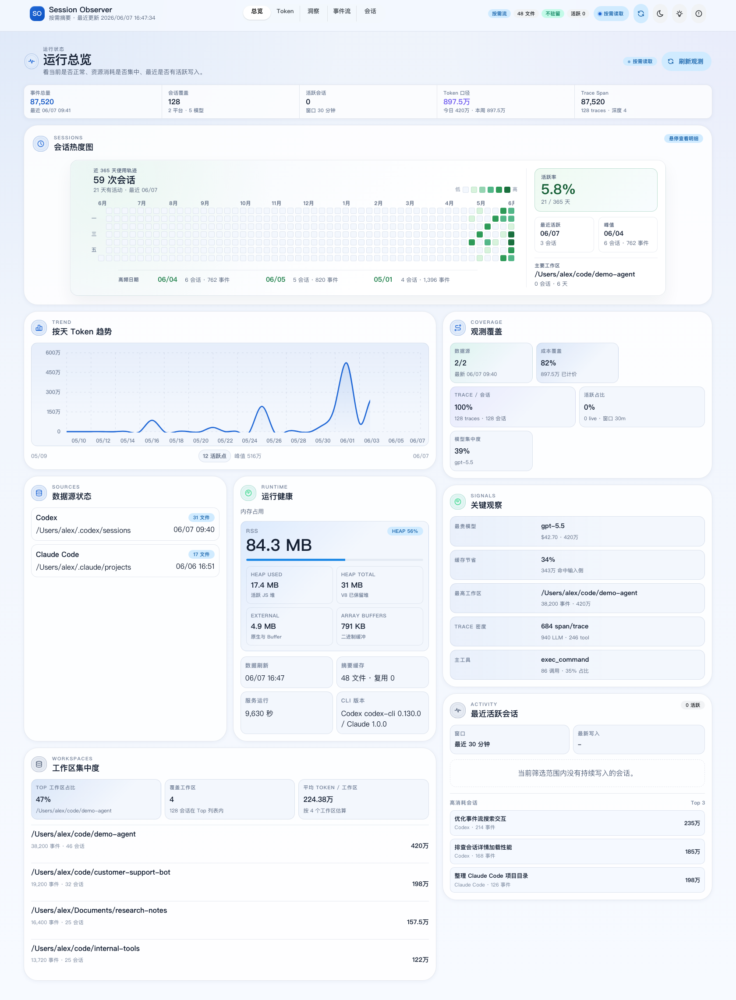
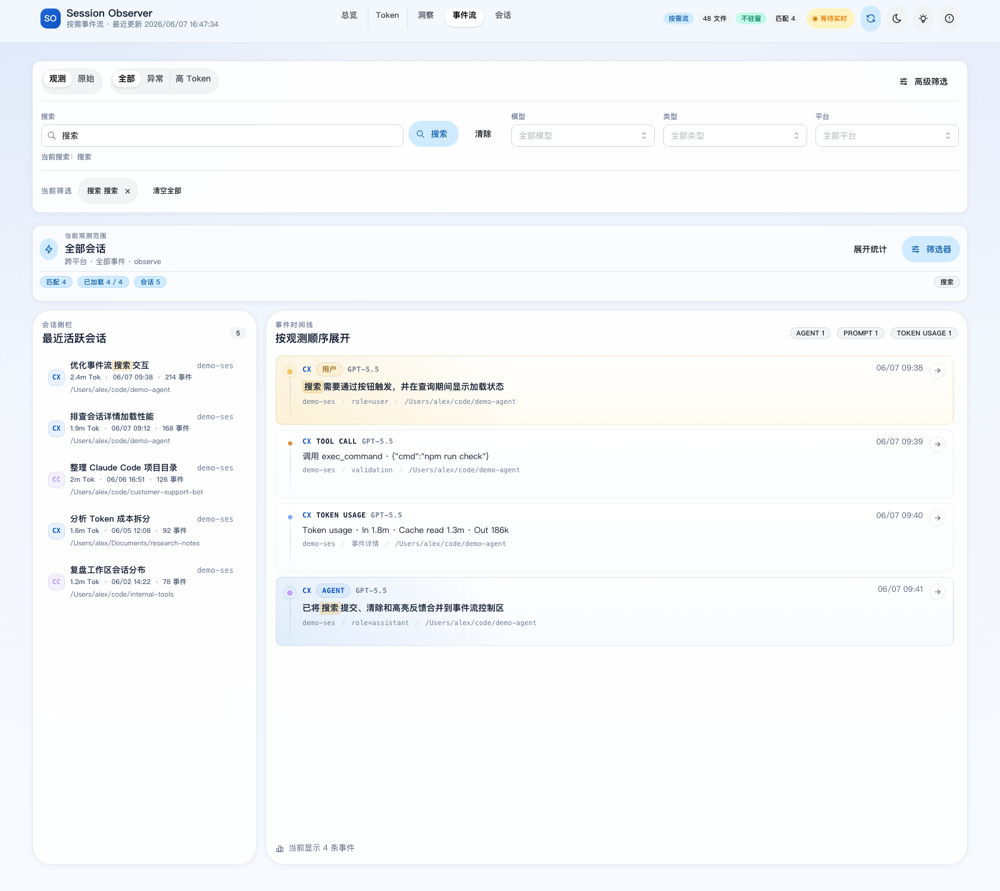
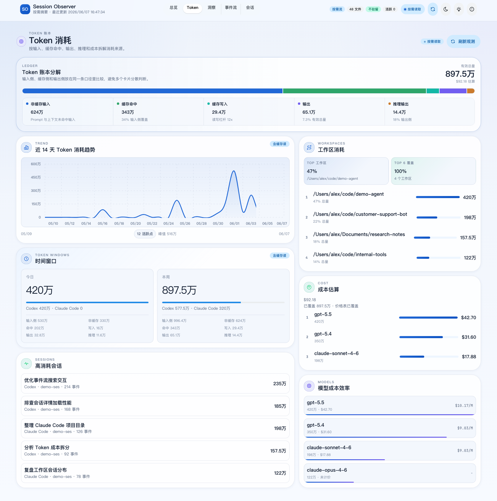
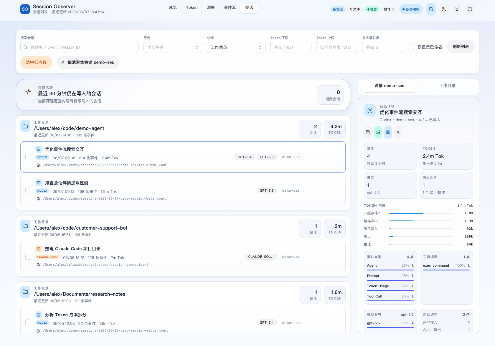

# Session Observer

**面向 Codex 与 Claude Code 的本地优先会话观测工作台。** 将散落在本机的 JSONL 会话记录整理成语义事件流、可搜索的会话库、Token 与成本账本，以及运行健康面板，全程不需要上传 prompt、工具输出或源码路径。

[](https://github.com/Ax-For/session-observer/actions/workflows/ci.yml)
[](LICENSE)
[](package.json)
[](package.json)
[](#隐私模型)

[English](README.md)



Session Observer 面向同时使用多个本地编码 Agent 的开发者，重点解决这些实际问题：

- 当前有哪些会话仍在写入，最近发生了什么？
- 用户问了什么、Agent 如何回答，中间执行了哪些工具？
- 输入、缓存读取、缓存写入、输出、推理 Token 和估算成本分别来自哪里？
- 哪些模型、工作区、文件和命令占用了主要资源？
- 面对数百 MB 的会话文件，能否不创建庞大的全量事件索引？

## 30 秒启动

```bash
npm install
./manage.sh start
./manage.sh open
```

默认地址为 [http://127.0.0.1:8787](http://127.0.0.1:8787)，不需要注册账号或部署外部数据库。

`manage.sh` 会按需构建 Vite 前端，并使用受约束的 Node 堆参数启动服务。仅调试前端时可以运行 `npm run dev`。

## 核心工作面

| 页面 | 主要用途 |
| --- | --- |
| **运行总览** | 实时输出 tok/s、近 5 分钟速度曲线、各 Agent 状态、7 项综合性能评分与 14 天同模型基线、服务与数据源健康、今日活动、24 小时负载和工作区集中度 |
| **Token 账本** | 非缓存输入、缓存命中、缓存写入、输出、推理输出、估算成本、效率指标、趋势与预测、模型归因、工作区归因和高成本会话 |
| **事件流** | 按用户回合归组的语义活动、问答/工具/用量/原始视图、按钮触发搜索、筛选、高亮、实时跟随/暂停，以及跳转到会话详情 |
| **会话管理** | 活跃会话、工作区分组、目录树、完整会话统计、开始与最近时间、可折叠对话、活动、用量、文件/工具、命令、错误、上下文压缩和原始诊断 |

会话工作台同时支持执行回放、两会话对比和本地成果标注。对比使用紧凑摘要，不需要载入完整会话正文。Token 页面还会显示成本覆盖率、会话 Token 覆盖率、价格表版本和预算提醒。

### 新增分析能力

| 入口 | 能力 |
| --- | --- |
| Token → 统计审计与历史价格 | 重算前后 Token / 金额差异、受影响会话、源文件和解析版本；按精确模型、档位、生效时间配置 USD 价格 |
| 会话 → 用量 | 当前载入窗口的逐轮 Token、金额估算、工具配对数量和累计耗时 |
| 会话 → 成果 | 父子 Agent 关联、独立用量归属，以及会话时间窗口内的只读 Git 提交证据 |
| 事件流 / 对话 | 保存筛选视图、消息书签和一键回到源会话 |
| 顶部 → 服务诊断 | 主进程与查询进程合计 RSS、任务进度、取消查询、文件监听状态与恢复 |

工具耗时只按调用 ID 配对，不把相邻日志的时间差当作工具耗时；并行调用的累计时间不等于会话时长。Git 提交的时间相关性不代表由该会话创建。子 Agent 的包含式汇总不会重复计入全局总量。

## 设计重点

### 默认看语义活动，而不是底层日志噪声

事件流会把一个用户回合、Agent 回复、工具调用、Token 快照、模型、耗时和错误归并成一个可展开活动。原始视图仍用于排查，但正常使用时不再被内部记录淹没。

搜索通过按钮显式触发，只匹配用户与 Agent 的问答内容，不会因为内部元数据、路径或 Token 记录产生大量无效结果。

默认将完整问答正文分块缓存在本机 SQLite 中，不保存图片编码和工具输出。未变化文件直接复用，增长文件从上一条完整记录续读；文件替换、截短或抽样内容校验变化会重建，已删除文件会移出缓存。首次准备显示文件进度，可以取消，已完成文件会保留。需要 Node.js 支持 `node:sqlite`；缓存可删除重建，不修改源日志。

搜索结果展示命中位置摘要和每个会话的匹配数量，点击直接打开附近对话，并可返回原搜索结果。日志更新只显示提示，不会中断关键词检索或自动重置结果。浏览器事件页同时限制在 4,000 条与约 8 MiB 的序列化体积估算预算内；可见长正文按最多 64 Ki 字符、两路并发分段读取。记录 JSON 仅展开时读取，超大字段会明确标注精简状态。旧扫描模式、损坏或层级过深的 JSON 仍可能不完整，页面会提示。

### 一个统一的会话工作台

从事件流或活跃会话跳转时，都会进入同一个详情工作台。完整事件数和 Token 总量来自稳定摘要，对话内容则从有界的最近窗口读取。默认先加载最新 400 条原始事件，对话按回合折叠，更早内容只在用户请求时继续读取。

会话列表默认只显示主会话，可切换为全部或仅子 Agent。主会话详情集中列出关联子 Agent，支持打开子会话和返回父会话；无法找到父会话的子 Agent 仍可在筛选后查看。活跃数量按主会话归组，关键词搜索保留子 Agent 的命中和父会话信息。父子会话各自的 Token 独立归属，不因列表归组重复累加，也不会预加载所有子会话正文。

### 更细的 Token 与成本归因

Token 统计明确拆分为：

- 非缓存输入；
- 缓存读取；
- 缓存写入；
- 模型输出；
- 推理输出。

页面可以按时间窗口、模型、平台、工作区和会话查看消耗。金额根据已识别模型的价格表估算，并不等同于供应商最终账单。

计价优先使用日志记录的消息金额，其次使用本地历史价格，最后才是内置参考价格。未知模型不套用通用价格。解析覆盖率和成本覆盖率是事实指标，不代表“统计准确率”；未覆盖、超限和无法解析的数据会明确提示。

### 面向大型本地会话历史

Session Observer 不会把完整会话库长期保留在内存中：

- 最近事件合并各文件的反向扫描结果，使用稳定游标继续翻页；
- 已完成且未变化的归档文件复用摘要；
- 正在增长的当前文件通过追加身份校验后只解析新增部分；
- 持久化摘要只保留有界的目标、结果、工具、文件、错误、上下文压缩和模型切换信息，不保存原始事件数组；
- 图片等超大字符串流式解析，不常驻二进制内容，同时保留行尾的用量元数据；
- 重型查询在单个有界、可取消的子进程执行，限制队列、超时和合计 RSS；
- 自动刷新保留已加载的历史阅读窗口；诊断面板显示 RSS、任务和监听状态。

因此，即使单个 JSONL 文件达到数百 MB，常规浏览也不需要构建常驻内存的全量事件索引。实际内存仍会受到会话结构、筛选条件和用户主动加载页数的影响。

`npm run test:memory` 使用实际写满的 400 MiB 数据验证统计、检索、回放、重算和取消恢复。本次 macOS 测量合计 RSS 峰值 172.9 MiB；这不是对任意数据的保证，超重查询会受到 280 MiB 保护阈值约束。详见[验收和限制](docs/reliability-upgrade.md)。

## 页面截图

截图使用脱敏示例数据，不包含真实 prompt、本机用户名路径、工具输出、凭据或原始 JSONL 内容。

| 运行总览 | 事件流 |
| --- | --- |
|  |  |

| Token 账本 | 会话工作台 |
| --- | --- |
|  |  |

## 数据来源

| 来源 | 默认路径 | 使用的数据 |
| --- | --- | --- |
| Codex 会话 | `~/.codex/sessions/**/*.jsonl` | Prompt、Agent 消息、工具调用、Token、模型、时间和工作目录 |
| Claude Code 项目 | `~/.claude/projects/**/*.jsonl` | 项目会话、消息、工具活动、模型和用量 |
| Codex state DB | `~/.codex/state_5.sqlite` | 会话标题元数据，通过 `sqlite3` CLI 读取 |

服务通过文件系统通知感知源文件变化，并将变化推送给浏览器。事件分页和搜索仍按需读取，不会转化成永久驻留内存的全局索引。

## 环境要求

- Node.js LTS 或更新版本
- npm
- `sqlite3` CLI，用于读取 Codex 标题元数据
- 现代桌面浏览器

## 常用命令

```bash
./manage.sh start      # 后台启动服务
./manage.sh status     # 查看 PID 和本地地址
./manage.sh logs -f    # 跟随运行日志
./manage.sh stop       # 停止服务
./manage.sh run        # 前台运行

npm test               # 前端 Vitest 测试
npm run test:core      # 解析、聚合、缓存和路由测试
npm run build          # 构建生产前端
npm run check          # lint、全部测试和生产构建
npm run test:e2e       # 1280 / 1440 桌面浏览器回归
npm run test:memory    # 400 MiB 密集日志内存验收
```

## 项目结构

```text
server.js              本地 HTTP API 与前端静态资源服务
manage.sh              服务生命周期和内存约束参数
server/                按需扫描、源文件监听、摘要缓存和路由
shared/                Codex / Claude Code 解析、去重、Token、Trace 和聚合逻辑
src/app.jsx            React 外壳、URL 状态和工作区编排
src/components/        总览、Token、事件流、会话库和详情工作面
src/hooks/             数据加载、源文件变化、分页和会话操作
src/lib/               活动模型、视图模型、格式化、分页和 URL 工具
tests/                 Node 侧解析、缓存、内存、路由和 Trace 测试
```

主 Node 进程负责 HTTP 与文件变化通知，单个查询子进程负责读取和分析，空闲 30 秒后退出。React 界面由 Vite 构建。共享解析层确保服务端摘要和前端视图使用一致的事件语义。

## 配置

| 变量 | 默认值 | 说明 |
| --- | --- | --- |
| `HOST` | `127.0.0.1` | HTTP 监听地址 |
| `PORT` | `8787` | HTTP 端口 |
| `CODEX_SESSIONS_DIR` | `~/.codex/sessions` | Codex 会话目录 |
| `CLAUDE_PROJECTS_DIR` | `~/.claude/projects` | Claude Code 项目目录 |
| `CODEX_STATE_DB` | `~/.codex/state_5.sqlite` | Codex 标题元数据数据库 |
| `OBSERVER_DAILY_TOKEN_BUDGET` | 未启用 | 当天 Token 预算 |
| `OBSERVER_WEEKLY_TOKEN_BUDGET` | 未启用 | 近 7 天 Token 预算 |
| `OBSERVER_DAILY_COST_BUDGET_USD` | 未启用 | 当天估算成本预算 |
| `OBSERVER_WEEKLY_COST_BUDGET_USD` | 未启用 | 近 7 天估算成本预算 |
| `OBSERVER_DIALOGUE_SEARCH` | `sqlite` | 默认使用轻量问答正文缓存；`scan` 可退回旧的有限扫描模式 |
| `OBSERVER_SOURCE_ADAPTERS_FILE` | 未启用 | 附加通用 JSONL 数据源清单 |
| `OBSERVER_ACCESS_TOKEN` | 未启用 | 非本机监听必须设置；HTTP Basic 密码 |
| `OBSERVER_ALLOWED_HOSTS` | 未启用 | 逗号分隔的额外 Host 白名单，含端口 |
| `OBSERVER_ALLOW_SOURCE_MUTATIONS` | `0` | 显式设为 `1` 才允许修改、删除原始会话 |
| `OBSERVER_PRICEBOOK_FILE` | `.runtime/pricebook.json` | 本地历史模型价格 |

```bash
PORT=8790 CODEX_SESSIONS_DIR=/path/to/codex/sessions ./manage.sh start
```

## 隐私模型

会话记录可能包含 prompt、源码、工具输出、文件路径和凭据。Session Observer 按本地检查场景设计：

- 默认服务只监听 `127.0.0.1`；
- 会话 JSONL 和 `.runtime/` 运行产物不会进入版本控制；
- 搜索和统计都直接针对本机文件执行；
- 不要求遥测、托管存储或第三方账号。

只有在明确理解暴露风险时才绑定非本机地址：

```bash
HOST=0.0.0.0 OBSERVER_ACCESS_TOKEN="$MY_LOCAL_TOKEN" \
  OBSERVER_ALLOWED_HOSTS="observer.local:8787" ./manage.sh start
```

浏览器 Basic 登录的用户名任意，密码为访问令牌；网络访问应使用 HTTPS 反向代理。源会话默认只读，本地书签、标注仍可写。保存视图、书签、价格和最近十次重算审计保存在 `OBSERVER_RUNTIME_DIR`（默认 `.runtime/`），删除该目录前请备份这些文件。

## 项目资源

- [参与贡献](CONTRIBUTING.md)
- [安全策略](SECURITY.md)
- [行为准则](CODE_OF_CONDUCT.md)
- [MIT License](LICENSE)
- [社交预览图](docs/social-preview.png)

## Roadmap

- 支持更多本地编码 Agent。
- 跨会话时间线 Diff。
- 供应商实际账单对账与保留策略。
- 更多大型语料和文件系统兼容性用例。
